<h1 align="center">
  <picture>
    <source media="(prefers-color-scheme: dark)" srcset="https://readme-typing-svg.herokuapp.com/?font=Inter&weight=600&size=32&center=true&vCenter=true&width=600&height=50&color=F0F6FC&duration=4000&lines=Hi+there!+👋;I'm+Brayden+Uglione!;Future+SWE+%2F+DS+%2F+ML+Engineer+💻;CS+%2B+Data+Science+@+Rutgers+🎓;I+love+building+things+🛠️;Open+to+Summer+2027+internships+🎯" />
    
  </picture>
</h1>
<h3 align="center">Aspiring Software Engineer · Data Scientist · ML Engineer | CS + Data Science @ Rutgers Honors College</h3>

## 🤖 About Me

I'm a Computer Science and Data Science student at Rutgers Honors College (minors in Math and Statistics) working toward a career in **software engineering**, **data science** or **machine learning**. I build applied AI systems, especially **retrieval-augmented generation (RAG)** and **LLM** pipelines, and I care about making them work reliably for the people who use them.

- 🏆 **NASA Space Apps NYC 2026:** won 2 awards for [Tranquility Base](https://github.com/rohansh2017/Space-Apps-2026), a lunar landing site navigator
- 🔭 **Now:** AI Studio Fellow with **Zayi**, building an agentic RAG system for R&D teams
- 🎓 **Break Through Tech AI/ML Fellow**, with Cornell University's Machine Learning Foundations certificate
- ⚖️ **Head of Judging @ HackRU**, where I built the judging platform used for 100+ projects and 25+ judges
- 🧑‍🏫 **Education & Mentorship @ USACS** (Rutgers' largest CS org): launched Speaker Talks, matched 40+ mentees
- 🎯 **Looking for:** Summer 2027 SWE / Data Science / ML internships

## 🚀 Featured Projects

| Project | What it does | Stack |
|---|---|---|
| 🏆 [Tranquility Base](https://github.com/rohansh2017/Space-Apps-2026) · [live](https://tranquility-base.rohansh2017.workers.dev) | **NASA Space Apps NYC 2026: Best Use of Code & Technology + Best Use of Gemini.** Lunar south-pole landing site navigator: stand on real LRO LOLA terrain in 3D, see the Sun and Earth at their true positions, and find alternative sites and dates when a launch slips | TypeScript, React, three.js, Python, Gemini, Cloudflare Workers |
| [Zayi AI Studio: Agentic Knowledge System](https://github.com/BrantisIsHacking/Zayi-1B-agentic-internal-knowledge-system-for-r-and-d) | Agentic RAG system for internal R&D knowledge retrieval | Python, ChromaDB, LLMs |
| [debate-mate](https://github.com/BrantisIsHacking/debate-mate) | AI debate coach that detects 10+ logical fallacies with 85%+ accuracy | Next.js, TypeScript, Gemini, Snowflake |
| [airbnb-price-classification](https://github.com/BrantisIsHacking/airbnb-price-classification) | Predicts high-priced NYC Airbnb listings, comparing logistic regression with a neural network | Python, scikit-learn, TensorFlow |
| [vestibular-problems-detector](https://github.com/BrantisIsHacking/vestibular-problems-detector) | ML prototype that detects vestibular problems in concussion patients from eye-tracking data | Python, Jupyter |
| [DreamsComeTrue](https://github.com/Ananya-Jha-code/DreamsComeTrue) · [live](https://dreamscometrue.work/) | **HackPrinceton Spring 2026.** Speak a story and watch it become an illustrated picture book: speech-to-text, LLM page structuring and per-page image generation, streamed to the UI as pages finish | React, TypeScript, Express, FastAPI, Gemini, ElevenLabs, K2 Think |

## 🛠️ Languages & Tools

## 📊 GitHub Activity

<picture>
  <source media="(prefers-color-scheme: dark)" srcset="https://raw.githubusercontent.com/BrantisIsHacking/BrantisIsHacking/output/tetris-contribution-graph-dark.svg">
  <source media="(prefers-color-scheme: light)" srcset="https://raw.githubusercontent.com/BrantisIsHacking/BrantisIsHacking/output/tetris-contribution-graph.svg">
  
</picture>
